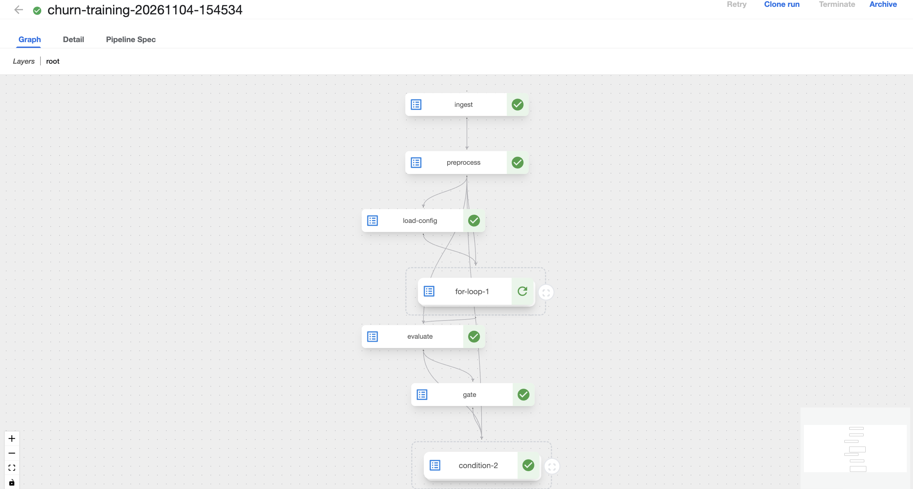
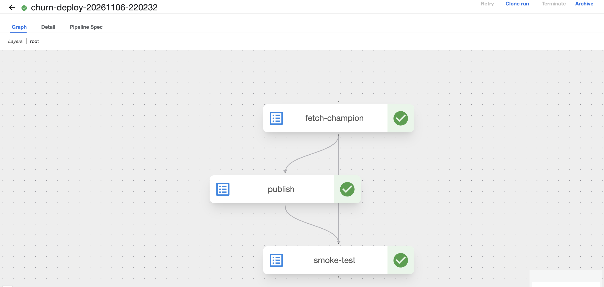
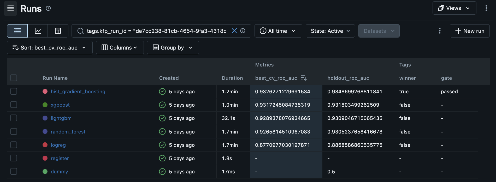
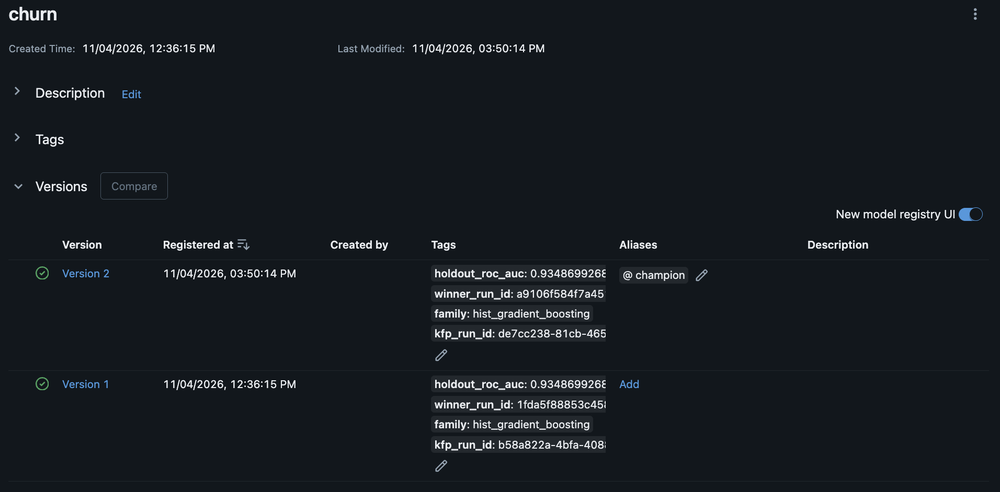
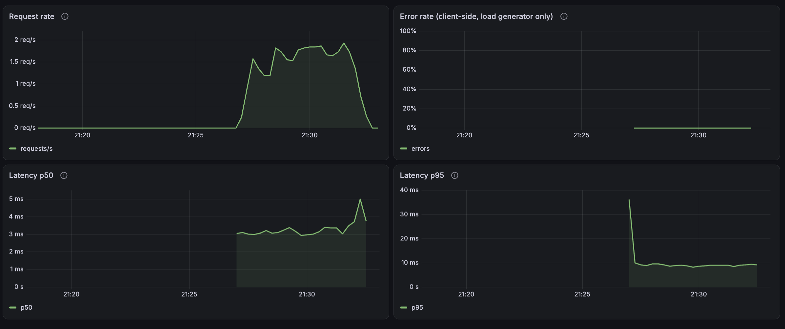

# Bank Customer Churn — End-to-End MLOps on Kubeflow


[](LICENSE)

A tabular dataset taken from raw CSV to a **monitored, served model**, the way a small ML team would do it: a reproducible training pipeline, experiment tracking, a model registry, a separate deployment pipeline, and basic observability. Everything runs locally on minikube. The point is the MLOps flow, not the last 0.001 of AUC.

| | |
|---|---|
| **Task** | Predict the probability that a bank customer churns (`Exited`). Binary classification, ROC-AUC |
| **Champion** | `HistGradientBoostingClassifier`, hold-out AUC **0.9349**, served by KServe |
| **Kaggle** | Public score **0.92989**, from the predictions of the *served* model |
| **Stack** | minikube · Kubeflow Pipelines 2.15 · KServe 0.21 · MLflow 3.17 · Optuna · scikit-learn 1.5.2 · XGBoost · LightGBM · Prometheus (Helm) · Grafana |


## Data

- **Source:** the Kaggle competition `bank-customer-churn-prediction-challeng-zhenliu`, with synthetic data generated from the original Bank Customer Churn dataset. `train.csv` has 15,000 rows (20.35 % churn, no nulls) and `test.csv` 10,000 rows without label.
- **Features, in a fixed order shared by training, serving and the load generator:** CreditScore, Geography, Gender, Age, Tenure, Balance, NumOfProducts, HasCrCard, IsActiveMember, EstimatedSalary. `id`, `CustomerId` and `Surname` are dropped (`id` is kept aside only to build the submission).
- **Metric:** ROC-AUC, plus PR-AUC, recall, F1 and the confusion matrix. Accuracy is not used for decisions, because only 20 % of the rows are positive.
- **Policy:** the data is for learning only. It lives in `data/` (git-ignored) and is never committed or published. The exploratory analysis is in [`docs/eda-summary.md`](docs/eda-summary.md) and `notebooks/eda.ipynb`.

## How it works

1. **Training pipeline (KFP v2).** Ingest and validate → preprocess (stratified 80/20 split) → tune five model families in parallel (Optuna TPE, 5-fold stratified CV, every trial logged to MLflow) → evaluate on the hold-out against a `DummyClassifier` baseline → **gate** → register.
2. **Gate.** A winner is registered only if its hold-out AUC beats the Dummy baseline by more than 0.05 **and** is at least the current champion's. Register then refits the winner on train + hold-out and sets the alias `@champion` on the new model version.
3. **Deploy pipeline (KFP v2, separate).** Fetch `models:/churn@champion` → save it as `model.joblib` on a PVC → create or patch the KServe `InferenceService` and wait for the rollout → smoke test the live endpoint against that exact file.
4. **Serving.** KServe in Standard mode (no Istio or Knative). Preprocessing travels *inside* the model, as one scikit-learn `Pipeline`, so training and serving cannot drift apart.
5. **Load and submission.** A load generator Job replays `test.csv` against the endpoint at a fixed rate and writes `submission.csv` from the served model's answers.
6. **Monitoring.** Prometheus scrapes the predictor and the generator. A Grafana dashboard, provisioned from the repo, shows request rate, p50 and p95 latency and an error rate.

## Results

Hold-out and CV ROC-AUC of the training pipeline run behind the current champion (3 Optuna trials per family):

| Model family | CV AUC (5-fold) | Hold-out AUC |
|---|---|---|
| **HistGradientBoosting** (champion) | 0.9326 | **0.9349** |
| XGBoost | 0.9317 | 0.9318 |
| LightGBM | 0.9289 | 0.9309 |
| Random Forest | 0.9266 | 0.9305 |
| Logistic Regression | 0.8771 | 0.8869 |
| Dummy baseline | — | 0.5000 |

- **Kaggle public score: 0.92989**, about 0.005 under the hold-out. That is the size of the error of a 3,000-row hold-out, and the public score covers only part of the test set. The level fits ROC-AUC; the competition's metric is still not confirmed from its page.
- **Serving (dashboard run):** the generator sustained about 1.7 requests per second with 100 rows per request; the predictor's predict step showed p50 near 3 ms and p95 near 9 ms.
- **More trials would not help much.** A laptop simulation of the same study with 30 trials per family reached CV 0.934 for the boosters, and a 250-trial search over wider ranges gained only about 0.0003. The data is synthetic and the models sit on a plateau near 0.935.

<table>
<tr>
<td width="50%"><br><sub>Training pipeline in the KFP UI</sub></td>
<td width="50%"><br><sub>Deploy pipeline in the KFP UI</sub></td>
</tr>
<tr>
<td><br><sub>MLflow: one run per family, the winner and the gate result</sub></td>
<td><br><sub>Model registry: alias <code>champion</code> on version 2</sub></td>
</tr>
</table>



## Design decisions

| Decision | Why |
|---|---|
| Preprocessing inside the model; columns selected **by position** in a frozen `FEATURES` order | KServe v1 sends a bare array, so there is no train/serve skew. A wrong order would fail silently, so the smoke test and the load generator build every payload from the same constant |
| Config-driven tuning (`components/tuning_config.json`) | A family, a range or the number of trials changes by editing JSON, with no Python change |
| Registry alias `@champion` decouples training from deployment | The deploy pipeline only asks for "the champion"; training can run without touching what is served |
| Model handoff: registry → `joblib` on a PVC → KServe `pvc://` | No object-store credentials, and the same file the smoke test compares against |
| Derived serving image `churn-sklearnserver` | KServe's stock sklearn server cannot load XGBoost or LightGBM models |
| Shared code and scripts travel in ConfigMaps | A code change needs no image rebuild |
| Error rate measured **client-side** | The predictor exports no metric with an HTTP status, so the load generator serves its own `load_requests_total{result="ok\|error"}` while it runs |
| Spec-driven development | Nine specs in [`specs/`](specs/) drove the work; the frozen contracts (target, features, split, metric, gate, registry) live in [`DECISIONS.md`](DECISIONS.md) |

## What went wrong, and what it taught

- **The 30-trial run did not fit.** On a single minikube node (8 CPUs, 6 GB) the full run overloaded the machine: load average of 231 and the whole KFP control plane restarting in a loop. The champion therefore comes from the 3-trial run, and the 30-trial numbers above are a local simulation, labelled as such. Grafana had taught the same lesson earlier: Grafana 13 inside the cluster overloaded the node, so it now runs in a container on the laptop.
- **A KFP flake.** KFP's own driver pods intermittently fail to reach `metadata-grpc` before any of our code runs. A failed run is retried *as the same run*, which keeps the finished steps.
- **A silent `NetworkPolicy`.** The `kubeflow` namespace drops traffic from other namespaces, so Prometheus scrapes timed out with no error until an extra policy opened the two metrics ports.
- **"Ready" is not "rolled out".** KServe can report an `InferenceService` ready while the old pod still answers. The deploy pipeline waits for the Deployment rollout and checks the endpoint against the saved file.
- **Limits by design:** a single node, no drift detection, no automatic retraining, no CI/CD, no authentication. The hold-out has 3,000 rows, so differences under about 0.005 AUC are noise.

## Reproduce

Prerequisites: Docker Desktop, minikube with Kubeflow Pipelines 2.15 and KServe 0.21 already installed, `kubectl`, Helm 4, `uv`, and the three Kaggle CSVs in `data/`.

```bash
minikube start
uv sync
# data PVC, images, MLflow, then the two pipelines:
uv run python tools/submit_pipeline.py                      # training (on a node this small, set n_trials to 3 first)
uv run python tools/submit_pipeline.py --pipeline deploy    # deploy the champion
docker compose -f docker/grafana/compose.yaml up -d         # Grafana at http://localhost:3000
```

[`docs/runbook.md`](docs/runbook.md) has the full path, step by step, from `minikube start` to Grafana, plus a table of gotchas by symptom and the measurements behind every decision.

## Repository layout

```
├── architecture.svg
├── components/     # KFP components (ingest, preprocess, tune, evaluate, gate, register, fetch, publish, smoke test) and the shared code
├── pipelines/      # training_pipeline.py, deploy_pipeline.py
├── tools/          # submit_pipeline.py, load_generator.py, check_submission.py, sync_code.sh
├── k8s/            # PVC, MLflow, ServingRuntime, RBAC, Helm values, monitors, NetworkPolicies, load-generator Job, dashboard JSON
├── docker/         # churn-base, churn-sklearnserver, grafana (compose and provisioning)
├── specs/          # one spec per unit of work
├── docs/           # runbook, EDA summary, screenshots
├── notebooks/      # exploratory analysis
└── DECISIONS.md    # frozen contracts and the decision log
```

## License

The code is released under the [MIT License](LICENSE). The data is not covered by it: the Kaggle files are for learning only and are not part of this repository.
