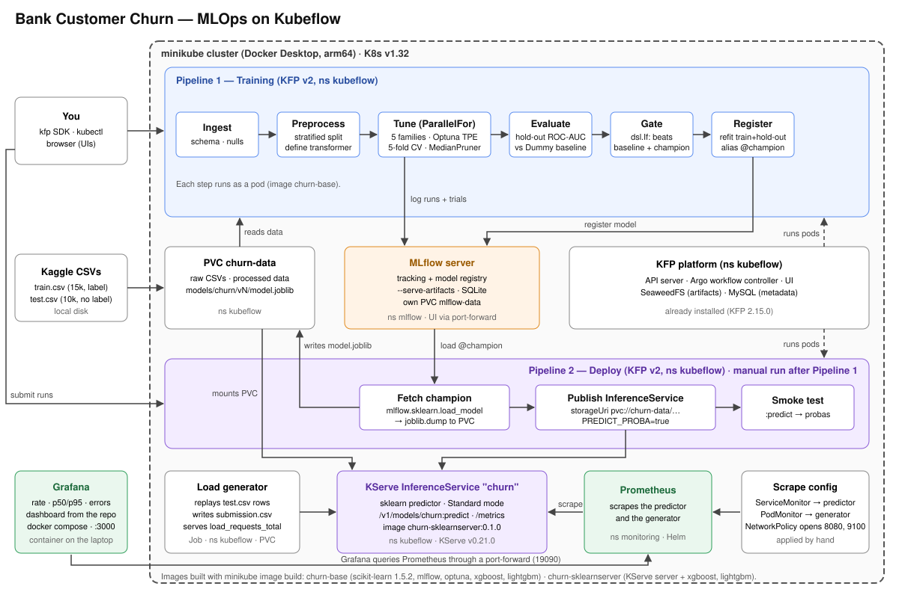

# Bank Customer Churn — End-to-End MLOps on Kubeflow


## 1. Goal

Take a tabular dataset from raw CSV to a **monitored, served model**, the way a small ML team would do it in a company: reproducible training pipeline, experiment tracking, a model registry, a separate deployment pipeline, and basic observability. The point is the **MLOps flow**, not squeezing the last 0.001 of AUC.

Everything runs locally on minikube (Apple Silicon Mac, Docker Desktop), on top of the Kubeflow Pipelines 2.15.0 and KServe 0.21.0 already installed while studying the book.

## 2. Problem and data

- **Task:** predict the probability that a bank customer churns (`Exited` = 1). Binary classification, probability output.
- **Source:** Kaggle competition `bank-customer-churn-prediction-challeng-zhenliu`. Synthetic data generated by a deep-learning model from the original Bank Customer Churn dataset (close to, not identical to, the original; using the original as extra data is allowed).
- **Local files** (`data/`, git-ignored): `train.csv`, `test.csv`, `sample_submission.csv`.

| File | Rows | Notes |
|---|---|---|
| `train.csv` | 15,000 | target `Exited`, ~20.35 % positives, no nulls |
| `test.csv` | 10,000 | no label; ids 15000+ |
| `sample_submission.csv` | 10,000 | `id,Exited` (probability) |

- **Features (fixed order, shared by training, serving and the load generator):** CreditScore, Geography (France/Germany/Spain), Gender, Age, Tenure, Balance, NumOfProducts, HasCrCard, IsActiveMember, EstimatedSalary.
- **Dropped:** `id`, `CustomerId`, `Surname` (identifiers / noise). `id` is kept aside only to build the submission.
- **Metric:** ROC-AUC (main), plus PR-AUC, recall, F1 and confusion matrix. Accuracy is not used for decisions (20 % positives). Competition metric not confirmed from the page; assumed ROC-AUC.
- **Data policy:** for learning only, never published or committed (see `.gitignore`).
- **EDA:** key findings with charts in [`docs/eda-summary.md`](docs/eda-summary.md); the full analysis is in `notebooks/eda.ipynb`.

## 3. Scope

### In scope
1. **Pipeline 1 — Training (KFP v2):** ingest and validate → preprocess → tune three scikit-learn models in parallel with Optuna and stratified CV → evaluate on a hold-out split against a Dummy baseline → quality gate → refit and register the champion.
2. **MLflow in the cluster:** tracking server + model registry (SQLite backend, artifacts on its own PVC, `--serve-artifacts`).
3. **Pipeline 2 — Deploy (KFP v2):** fetch the champion from the registry → convert to `model.joblib` on the data PVC → publish a KServe `InferenceService` → smoke test `:predict`.
4. **Serving:** KServe sklearn predictor in Standard mode (no Istio/Knative), returning probabilities.
5. **Monitoring:** Prometheus + Grafana dashboard (request rate, p50/p95 latency, error rate) fed by a load generator that replays `test.csv`.
6. **Submission file:** the load generator collects the endpoint's answers for `test.csv` and writes `submission.csv` in Kaggle format, so the submission comes from the *served* model.
7. **Custom images:** `churn-base`, used by every pipeline step and the load generator, and `churn-sklearnserver`, the KServe sklearn server plus XGBoost and LightGBM, used by the InferenceService.
8. **Documentation:** this README, the architecture SVG, and `docs/runbook.md` with the commands actually used.

### Out of scope (explicitly)
- Data/feature drift detection and live model-quality monitoring (no labels in production).
- Auto-retraining triggers, CI/CD, GitOps, multi-user Kubeflow, auth.
- Katib (Optuna inside the tuning pods covers HPO without extra cluster components), Feast/feature store, GPU, distributed training.
- Canary/traffic splitting (not supported in KServe Standard mode; see Ch08 notes).
- Using the original (non-synthetic) dataset. Optional later experiment.

## 4. Architecture



| Component | Namespace | Role | Status |
|---|---|---|---|
| minikube | — | Local K8s v1.29, 4 CPU / 6 GB | installed |
| Kubeflow Pipelines 2.15.0 | `kubeflow` | Orchestrates both pipelines (API, Argo, UI, SeaweedFS, MySQL) | installed |
| KServe 0.21.0 + cert-manager | `kserve` (controller only) | Serving control plane, Standard mode | installed |
| PVC `churn-data` | `kubeflow` | Raw/processed data, `models/churn/vN/model.joblib`, `submission.csv` | to create |
| MLflow server + PVC `mlflow-data` | `mlflow` | Experiment tracking + model registry | installed |
| InferenceService `churn` | `kubeflow` | Serves the champion from `pvc://churn-data/models/churn/vN` | created and patched by Pipeline 2 |
| ServingRuntime `churn-sklearnserver` | `kubeflow` | Copy of KServe's `kserve-sklearnserver` runtime that uses the image `churn-sklearnserver` | installed (`k8s/serving-runtime.yaml`) |
| Load generator (Job) | `kubeflow` | Replays `test.csv`, writes `submission.csv` | to write |
| Prometheus | `monitoring` | Serving metrics (Helm, `kube-prometheus-stack` 92.22.0, no Alertmanager) | installed, scrapes the predictor |
| Grafana | container on the laptop (`docker/grafana/compose.yaml`) | Dashboard, reads Prometheus through a port-forward | installed, dashboard in SPEC 09 |
| Image `churn-base` | — | Python + pinned scikit-learn, mlflow, optuna, pandas, joblib, kfp, xgboost, lightgbm | installed (`0.3.0`) |
| Image `churn-sklearnserver` | — | `kserve/sklearnserver:v0.21.0` plus `xgboost 3.2.0`, `lightgbm 4.7.0` and `narwhals` (which `lightgbm` requires), so a champion of any family loads | installed (`0.1.0`) |

**Namespace rule:** a pod can only mount a PVC from its own namespace. Pipeline pods, the InferenceService and the load generator all mount `churn-data`, so they all live in `kubeflow`. MLflow keeps its own PVC in `mlflow` and is reached over HTTP (`http://mlflow.mlflow.svc.cluster.local:5000`).

### Flow
1. **You** copy the CSVs to `churn-data` (helper pod + `kubectl cp`) and submit Pipeline 1 with the `kfp` SDK.
2. **Pipeline 1** reads data from the PVC. Each tuning pod runs an Optuna study for one model family; every trial is a nested run in **MLflow** under the family's parent run, which also logs the best params and the CV metrics (no model: only Register logs one). Evaluate refits each family's best config on train, scores the hold-out next to a `DummyClassifier` baseline, logs the hold-out metrics in each family's parent run and tags the winner (best CV AUC) with `winner=true`; Evaluate logs no model. The Gate compares the winner's hold-out AUC with the Dummy baseline and the current champion and tags the winner's run `gate=passed` or `gate=rejected`. If it passes, Register refits the best config on train + hold-out, logs the model (the only model logged in the pipeline), registers it as `churn`, tags the version with the pre-refit hold-out AUC and only then sets the alias `@champion`.
3. **Pipeline 2** (manual run) loads `models:/churn@champion`, saves it as `model.joblib` on the PVC, creates/updates the **InferenceService** and waits until the new pod answers and the old one is gone, and smoke-tests that `:predict` returns the probabilities of that exact model (it compares the answer with the saved file).
4. The **load generator** sends `test.csv` rows to the endpoint and writes `submission.csv`; **Prometheus** scrapes the serving metrics and **Grafana** shows them.

### Model handoff: MLflow → KServe
- Pipeline 1 logs with `mlflow.sklearn.log_model(...)` (standard MLflow format with signature and input example) and registers it. The registry stays the single source of truth and keeps the lineage (run, params, metrics).
- The **Fetch champion** step does `mlflow.sklearn.load_model("models:/churn@champion")` and `joblib.dump(model, "/mnt/data/models/churn/v<N>/model.joblib")`, because KServe's sklearn server expects a `model.joblib`/`model.pkl` file, not an MLflow model directory.
- This works only if training, Fetch and KServe's sklearnserver use **the same scikit-learn version**. `churn-base` pins it to the version shipped in the KServe 0.21 sklearnserver image.

### Where preprocessing runs at inference
There is no separate preprocessing step at serving time: the transformations travel **inside the model**. What gets registered (and later saved as `model.joblib`) is a full sklearn `Pipeline`:

```python
Pipeline([
    ("prep", ColumnTransformer([...])),   # one-hot Geography/Gender + scaling, columns by position
    ("clf",  HistGradientBoostingClassifier(...)),
])
```

- **Training side:** the Preprocess step only splits the data and *defines* the (unfitted) transformer. It is *fitted* later, inside each CV fold during Tune (no leakage from the validation fold) and finally on train + hold-out in Register. The fitted `prep` stores the training categories and the scaler's mean/std.
- **Serving side:** for every request the sklearnserver calls `model.predict_proba(instances)`; the `Pipeline` runs `prep.transform()` with the training parameters and then `clf.predict_proba()`. Same object for training and serving, so no train/serve skew.
- **Client side (load generator, `curl`):** drop `id`, `CustomerId`, `Surname` and send the remaining columns in the exact `FEATURES` order. Because the transformer selects columns by position, a wrong order would not raise an error, it would silently produce wrong predictions; the smoke test and the load generator both build the payload from `FEATURES` in `config.py`.
- If preprocessing ever needed something sklearn cannot hold (e.g. looking up external features), KServe supports a separate **Transformer** container in front of the predictor. Not needed here.

## 5. Design decisions

| Decision | Choice | Why |
|---|---|---|
| Models | Five families by default (LogisticRegression, RandomForest, HistGradientBoosting, XGBoost, LightGBM), defined in `components/tuning_config.json` | Scikit-learn, XGBoost and LightGBM classes with `predict_proba`, fast on 15k rows. A family or a hyperparameter is added by editing the JSON, with no change to Python |
| Baseline | `DummyClassifier(strategy="prior")` (AUC 0.5) | Minimum reference for the gate |
| Tuning | `ParallelFor` over model families (parallelism 2); inside each pod an **Optuna** study (TPE sampler, 30 trials by default set in `components/tuning_config.json`, fixed seed) maximizing mean ROC-AUC of stratified 5-fold CV, with `MedianPruner` reporting after each fold | Shows the KFP fan-out pattern; Bayesian search finds better params than random search in fewer trials; no Katib install; parallelism 2 limits SQLite contention and memory; one thread per pod (`n_jobs: 1` and `OMP_NUM_THREADS=1`), because the minikube node has a 4-core quota |
| Optuna storage | In-memory study per pod; results persisted in MLflow (one nested run per trial) | One study per family, nothing shared between pods, so no extra database |
| Preprocessing | `ColumnTransformer` that selects columns **by position** (fixed feature order), inside the same sklearn `Pipeline` as the model | KServe v1 sends a numpy array without column names; serving receives raw features, no train/serve skew |
| Split | Stratified 80/20 train/hold-out with a fixed seed | Same hold-out across runs, so champions are comparable |
| Gate | Hold-out ROC-AUC > Dummy baseline + 0.05 **and** ≥ current champion's hold-out AUC (if one exists) | Realistic "do not ship a worse model" step |
| Final model | Refit the winning config on train + hold-out before registering | Uses all labeled data; hold-out metric is reported from the pre-refit model |
| Registry | MLflow Model Registry, model `churn`, alias `@champion` | Decouples training from deployment |
| Model handoff | Registry → `joblib` on PVC → KServe `storageUri: pvc://churn-data/…` | Same pattern that worked in Ch08; avoids S3 credentials |
| Probabilities | `PREDICT_PROBA=true` env var on the sklearn predictor | `:predict` returns labels by default; submission needs probabilities (to verify in Phase 0) |
| Images | `churn-base` (scikit-learn, mlflow, optuna, pandas, joblib, kfp, xgboost, lightgbm) for the pipeline steps, and `churn-sklearnserver` (the KServe sklearn server plus xgboost, lightgbm) for serving, both built with `minikube image build` | No `pip install` at every step; pins the sklearn version; the stock server image cannot load XGBoost or LightGBM models |
| Monitoring install | Helm (`kube-prometheus-stack`), install Helm with `brew install helm` | Standard way; Helm 4.3.1 installed. Grafana runs outside the cluster (see SPEC 08) |
| Cluster memory | Keep minikube at 6 GB for now | 15k rows is light. Measured after the monitoring install: node of 7.8 GB with about 2.3 GB available and 14 GB of disk free |

## 6. Phases and acceptance criteria

| Phase | Work | Done when | Est. |
|---|---|---|---|
| 0 | Project skeleton, `churn-base` image, PVC with the CSVs, local baseline, **serving spike**: a dummy sklearn `Pipeline` saved as `model.joblib` on the PVC, served by KServe, queried with a raw row | `:predict` on a raw row (strings + numbers) returns probabilities; baseline AUC computed locally | 1.5 h |
| 1 | MLflow install + Pipeline 1 | A pipeline run in the KFP UI shows the tuned models in MLflow and `churn@champion` in the registry | 3–4 h |
| 2 | Pipeline 2 + KServe | `curl :predict` returns churn probabilities from the registered model | 1.5–2 h |
| 3 | Helm, Prometheus + Grafana, load generator | Grafana shows request rate and p95 latency while the generator runs; `submission.csv` written | 2–2.5 h |
| 4 | Polish | Runbook written, diagram updated to match reality | 0.5 h |

Total ≈ 9–10 h. No scope cuts; the deadline moves instead.

## Baseline results

5-fold stratified CV (`SEED = 42`) on all of `data/train.csv`, ROC-AUC, from `tools/baseline.py`:

| Model | Mean | Std |
|---|---|---|
| `DummyClassifier(strategy="prior")` | 0.5000 | 0.0000 |
| LogReg behind a position-based `ColumnTransformer` | 0.8789 | 0.0110 |

## 7. Risks and open questions

- **Probabilities from KServe:** verified in the Phase 0 spike (SPEC 02). With `PREDICT_PROBA=true`, `kserve-sklearnserver` v0.21 returns `{"predictions": [[p0, p1], ...]}`; the churn probability is the second column. No custom predictor is needed.
- **Raw input at serving:** verified in the Phase 0 spike (SPEC 02). Rows with strings and numbers in `FEATURES` order are scored correctly by a sklearn `Pipeline` with a position-based `ColumnTransformer`, and the answer matches the local `predict_proba` (maximum difference 0). No `FunctionTransformer` is needed.
- **XGBoost and LightGBM champions could not be served — solved (SPEC 07):** the KServe `sklearnserver:v0.21.0` image has neither library, so a registered `Pipeline` with one of them failed to load (`ModuleNotFoundError`, seen in the check of step 4). The derived image `churn-sklearnserver:0.1.0` adds `xgboost 3.2.0`, `lightgbm 4.7.0` and `narwhals` (required by `lightgbm`), and loads a model of each of the five families with a difference of 0 in `predict_proba`. A real XGBoost or LightGBM champion has not been deployed yet, because today's champion is `hist_gradient_boosting`.
- **scikit-learn version pinning:** read the version from the KServe 0.21 sklearnserver image before building `churn-base`.
- **SQLite under parallel writes:** possible `database is locked` with concurrent tuning runs (Optuna adds one MLflow run per trial, ~90 runs per pipeline run). Mitigation: parallelism 2 and client retries; fallback Postgres.
- **Metrics from KServe sklearn server:** solved. v0.21 exposes `/metrics` on port 8080 (histograms `request_*_seconds`), and Prometheus scrapes it through a `ServiceMonitor` on the Service. It has no metric with an HTTP status, so the error rate is decided in SPEC 09.
- **RBAC for Pipeline 2 — solved (SPEC 07):** `k8s/rbac-pipeline-runner.yaml` adds a Role `pipeline-runner-serving` (get, create, patch on `inferenceservices`; get, list on `servingruntimes`; no delete) and its RoleBinding to `pipeline-runner`. The existing Role `pipeline-runner` stays as it was. Reading the predictor Deployment and pods, which Publish also does, was already allowed by that existing Role.
- **A KServe rollout can look finished before it is (found in SPEC 07):** after a `patch`, the InferenceService stays `Ready`, and `observedGeneration` can catch up, while the new pod is not Ready and the old one is the only one answering. Publish therefore also waits for the Deployment rollout. See `docs/runbook.md` for the measurements.
- **The KFP flake is still open:** the drivers and launchers of KFP time out against `metadata-grpc` (`i/o timeout`): 8 of 9 attempts failed that way in one session (2026-11-06), and the cause is not known. A failed run is retried; see `docs/runbook.md`.
- **Memory:** MLflow + Prometheus + Grafana on top of KFP and KServe may not fit. Measured: Prometheus and its operator fit (node at about 2.3 GB available), but Grafana 13 inside the cluster overloaded the node (load average 254, restart loop), so it runs in a container on the laptop.
- **Competition metric:** to be confirmed on the Kaggle Evaluation tab.

## 8. Repo layout

```
portafolio/kubeflow/
├── README.md                  # this file
├── BACKLOG.md                 # epics and subtasks
├── architecture.svg
├── .gitignore                 # data, venvs, local outputs
├── data/                      # train.csv  test.csv  sample_submission.csv (git-ignored)
├── docker/churn-base/         # Dockerfile + requirements.txt (pinned)
├── k8s/                       # PVC, MLflow, InferenceService, load-generator Job, Helm values
├── notebooks/eda.ipynb        # exploratory analysis, committed with aggregated outputs only
├── components/                # KFP components: ingest, preprocess, load_config, tune, evaluate, register, fetch, publish, smoke_test; shared code in config.py, preprocessing.py, models.py and tuning_config.json
├── pipelines/
│   ├── training_pipeline.py   # Pipeline 1
│   └── deploy_pipeline.py     # Pipeline 2
├── tools/load_generator.py
└── docs/runbook.md
```

## 9. Review checklist (for iterating)

- [ ] Scope in/out is right
- [ ] Architecture diagram has every component you expect
- [ ] Model families, baseline, gate rule and metric are right
- [ ] Phase order (spike first) and acceptance criteria are right
- [ ] Folder layout is OK
