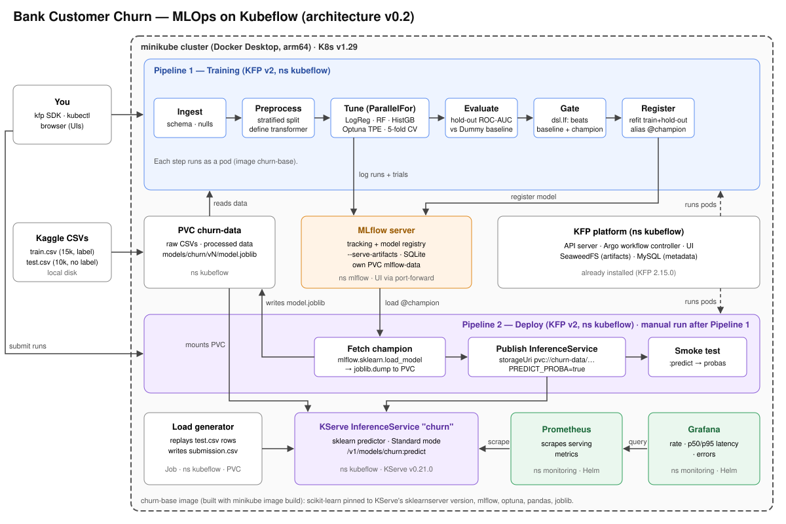

# Bank Customer Churn — End-to-End MLOps on Kubeflow


## 1. Goal

Take a tabular dataset from raw CSV to a **monitored, served model**, the way a small ML team would do it in a company: reproducible training pipeline, experiment tracking, a model registry, a separate deployment pipeline, and basic observability. The point is the **MLOps flow**, not squeezing the last 0.001 of AUC.

Everything runs locally on minikube (Apple Silicon Mac, Docker Desktop), on top of the Kubeflow Pipelines 2.15.0 and KServe 0.21.0 already installed while studying the book.

## 2. Problem and data

- **Task:** predict the probability that a bank customer churns (`Exited` = 1). Binary classification, probability output.
- **Source:** Kaggle competition `bank-customer-churn-prediction-challeng-zhenliu`. Synthetic data generated by a deep-learning model from the original Bank Customer Churn dataset (close to, not identical to, the original; using the original as extra data is allowed).
- **Local files** (`data/`, git-ignored): `train.csv`, `test.csv`, `sample_submission.csv`.

| File | Rows | Notes |
|---|---|---|
| `train.csv` | 15,000 | target `Exited`, ~20.35 % positives, no nulls |
| `test.csv` | 10,000 | no label; ids 15000+ |
| `sample_submission.csv` | 10,000 | `id,Exited` (probability) |

- **Features (fixed order, shared by training, serving and the load generator):** CreditScore, Geography (France/Germany/Spain), Gender, Age, Tenure, Balance, NumOfProducts, HasCrCard, IsActiveMember, EstimatedSalary.
- **Dropped:** `id`, `CustomerId`, `Surname` (identifiers / noise). `id` is kept aside only to build the submission.
- **Metric:** ROC-AUC (main), plus PR-AUC, recall, F1 and confusion matrix. Accuracy is not used for decisions (20 % positives). Competition metric not confirmed from the page; assumed ROC-AUC.
- **Data policy:** for learning only, never published or committed (see `.gitignore`).

## 3. Scope

### In scope
1. **Pipeline 1 — Training (KFP v2):** ingest and validate → preprocess → tune three scikit-learn models in parallel with Optuna and stratified CV → evaluate on a hold-out split against a Dummy baseline → quality gate → refit and register the champion.
2. **MLflow in the cluster:** tracking server + model registry (SQLite backend, artifacts on its own PVC, `--serve-artifacts`).
3. **Pipeline 2 — Deploy (KFP v2):** fetch the champion from the registry → convert to `model.joblib` on the data PVC → publish a KServe `InferenceService` → smoke test `:predict`.
4. **Serving:** KServe sklearn predictor in Standard mode (no Istio/Knative), returning probabilities.
5. **Monitoring:** Prometheus + Grafana dashboard (request rate, p50/p95 latency, error rate) fed by a load generator that replays `test.csv`.
6. **Submission file:** the load generator collects the endpoint's answers for `test.csv` and writes `submission.csv` in Kaggle format, so the submission comes from the *served* model.
7. **Custom base image `churn-base`** used by every pipeline step and the load generator.
8. **Documentation:** this README, the architecture SVG, and `docs/runbook.md` with the commands actually used.

### Out of scope (explicitly)
- Data/feature drift detection and live model-quality monitoring (no labels in production).
- Auto-retraining triggers, CI/CD, GitOps, multi-user Kubeflow, auth.
- Katib (Optuna inside the tuning pods covers HPO without extra cluster components), Feast/feature store, GPU, distributed training.
- Canary/traffic splitting (not supported in KServe Standard mode; see Ch08 notes).
- Using the original (non-synthetic) dataset. Optional later experiment.

## 4. Architecture



| Component | Namespace | Role | Status |
|---|---|---|---|
| minikube | — | Local K8s v1.29, 4 CPU / 6 GB | installed |
| Kubeflow Pipelines 2.15.0 | `kubeflow` | Orchestrates both pipelines (API, Argo, UI, SeaweedFS, MySQL) | installed |
| KServe 0.21.0 + cert-manager | `kserve` (controller only) | Serving control plane, Standard mode | installed |
| PVC `churn-data` | `kubeflow` | Raw/processed data, `models/churn/vN/model.joblib`, `submission.csv` | to create |
| MLflow server + PVC `mlflow-data` | `mlflow` | Experiment tracking + model registry | to install |
| InferenceService `churn` | `kubeflow` | Serves the champion from `pvc://churn-data/models/churn/vN` | to create (Pipeline 2) |
| Load generator (Job) | `kubeflow` | Replays `test.csv`, writes `submission.csv` | to write |
| Prometheus + Grafana | `monitoring` | Serving metrics and dashboard (Helm) | to install |
| Image `churn-base` | — | Python + pinned scikit-learn, mlflow, optuna, pandas, joblib | to build |

**Namespace rule:** a pod can only mount a PVC from its own namespace. Pipeline pods, the InferenceService and the load generator all mount `churn-data`, so they all live in `kubeflow`. MLflow keeps its own PVC in `mlflow` and is reached over HTTP (`http://mlflow.mlflow.svc.cluster.local:5000`).

### Flow
1. **You** copy the CSVs to `churn-data` (helper pod + `kubectl cp`) and submit Pipeline 1 with the `kfp` SDK.
2. **Pipeline 1** reads data from the PVC. Each tuning pod runs an Optuna study for one model family; every trial is a nested run in **MLflow** under the family's parent run, which also logs the best params, CV metrics and model. Evaluate compares the best model with a `DummyClassifier` baseline on the hold-out. If it passes the gate, the best config is refit on train + hold-out and registered with alias `@champion`.
3. **Pipeline 2** (manual run) loads `models:/churn@champion`, saves it as `model.joblib` on the PVC, creates/updates the **InferenceService**, and smoke-tests that `:predict` returns probabilities.
4. The **load generator** sends `test.csv` rows to the endpoint and writes `submission.csv`; **Prometheus** scrapes the serving metrics and **Grafana** shows them.

### Model handoff: MLflow → KServe
- Pipeline 1 logs with `mlflow.sklearn.log_model(...)` (standard MLflow format with signature and input example) and registers it. The registry stays the single source of truth and keeps the lineage (run, params, metrics).
- The **Fetch champion** step does `mlflow.sklearn.load_model("models:/churn@champion")` and `joblib.dump(model, "/mnt/data/models/churn/v<N>/model.joblib")`, because KServe's sklearn server expects a `model.joblib`/`model.pkl` file, not an MLflow model directory.
- This works only if training, Fetch and KServe's sklearnserver use **the same scikit-learn version**. `churn-base` pins it to the version shipped in the KServe 0.21 sklearnserver image.

### Where preprocessing runs at inference
There is no separate preprocessing step at serving time: the transformations travel **inside the model**. What gets registered (and later saved as `model.joblib`) is a full sklearn `Pipeline`:

```python
Pipeline([
    ("prep", ColumnTransformer([...])),   # one-hot Geography/Gender + scaling, columns by position
    ("clf",  HistGradientBoostingClassifier(...)),
])
```

- **Training side:** the Preprocess step only splits the data and *defines* the (unfitted) transformer. It is *fitted* later, inside each CV fold during Tune (no leakage from the validation fold) and finally on train + hold-out in Register. The fitted `prep` stores the training categories and the scaler's mean/std.
- **Serving side:** for every request the sklearnserver calls `model.predict_proba(instances)`; the `Pipeline` runs `prep.transform()` with the training parameters and then `clf.predict_proba()`. Same object for training and serving, so no train/serve skew.
- **Client side (load generator, `curl`):** drop `id`, `CustomerId`, `Surname` and send the remaining columns in the exact `FEATURES` order. Because the transformer selects columns by position, a wrong order would not raise an error, it would silently produce wrong predictions; the smoke test and the load generator both build the payload from `FEATURES` in `config.py`.
- If preprocessing ever needed something sklearn cannot hold (e.g. looking up external features), KServe supports a separate **Transformer** container in front of the predictor. Not needed here.

## 5. Design decisions

| Decision | Choice | Why |
|---|---|---|
| Models | LogisticRegression, RandomForest, HistGradientBoosting | Three families, all scikit-learn, fast on 15k rows |
| Baseline | `DummyClassifier(strategy="prior")` (AUC 0.5) | Minimum reference for the gate |
| Tuning | `ParallelFor` over model families (parallelism 2); inside each pod an **Optuna** study (TPE sampler, ~30 trials, fixed seed) maximizing mean ROC-AUC of stratified 5-fold CV, with `MedianPruner` reporting after each fold | Shows the KFP fan-out pattern; Bayesian search finds better params than random search in fewer trials; no Katib install; parallelism 2 limits SQLite contention and memory |
| Optuna storage | In-memory study per pod; results persisted in MLflow (one nested run per trial) | One study per family, nothing shared between pods, so no extra database |
| Preprocessing | `ColumnTransformer` that selects columns **by position** (fixed feature order), inside the same sklearn `Pipeline` as the model | KServe v1 sends a numpy array without column names; serving receives raw features, no train/serve skew |
| Split | Stratified 80/20 train/hold-out with a fixed seed | Same hold-out across runs, so champions are comparable |
| Gate | Hold-out ROC-AUC > Dummy baseline + 0.05 **and** ≥ current champion's hold-out AUC (if one exists) | Realistic "do not ship a worse model" step |
| Final model | Refit the winning config on train + hold-out before registering | Uses all labeled data; hold-out metric is reported from the pre-refit model |
| Registry | MLflow Model Registry, model `churn`, alias `@champion` | Decouples training from deployment |
| Model handoff | Registry → `joblib` on PVC → KServe `storageUri: pvc://churn-data/…` | Same pattern that worked in Ch08; avoids S3 credentials |
| Probabilities | `PREDICT_PROBA=true` env var on the sklearn predictor | `:predict` returns labels by default; submission needs probabilities (to verify in Phase 0) |
| Images | One custom image `churn-base` (scikit-learn, mlflow, optuna, pandas, joblib), built with `minikube image build` | No `pip install` at every step; pins the sklearn version |
| Monitoring install | Helm (`kube-prometheus-stack`), install Helm with `brew install helm` | Standard way; Helm is not installed yet |
| Cluster memory | Keep minikube at 6 GB for now | 15k rows is light; revisit if the monitoring stack gets tight |

## 6. Phases and acceptance criteria

| Phase | Work | Done when | Est. |
|---|---|---|---|
| 0 | Project skeleton, `churn-base` image, PVC with the CSVs, local baseline, **serving spike**: a dummy sklearn `Pipeline` saved as `model.joblib` on the PVC, served by KServe, queried with a raw row | `:predict` on a raw row (strings + numbers) returns probabilities; baseline AUC computed locally | 1.5 h |
| 1 | MLflow install + Pipeline 1 | A pipeline run in the KFP UI shows the tuned models in MLflow and `churn@champion` in the registry | 3–4 h |
| 2 | Pipeline 2 + KServe | `curl :predict` returns churn probabilities from the registered model | 1.5–2 h |
| 3 | Helm, Prometheus + Grafana, load generator | Grafana shows request rate and p95 latency while the generator runs; `submission.csv` written | 2–2.5 h |
| 4 | Polish | Runbook written, diagram updated to match reality | 0.5 h |

Total ≈ 9–10 h. No scope cuts; the deadline moves instead.

## Baseline results

5-fold stratified CV (`SEED = 42`) on all of `data/train.csv`, ROC-AUC, from `tools/baseline.py`:

| Model | Mean | Std |
|---|---|---|
| `DummyClassifier(strategy="prior")` | 0.5000 | 0.0000 |
| LogReg behind a position-based `ColumnTransformer` | 0.8789 | 0.0110 |

## 7. Risks and open questions

- **Probabilities from KServe:** `PREDICT_PROBA` is unverified for v0.21. Checked in the Phase 0 spike; fallback is a custom predictor (KServe `Model` subclass) in `churn-base`.
- **Raw input at serving:** mixed strings/numbers in a numpy array may be cast to strings. Checked in the Phase 0 spike; fallback is casting numerics inside the sklearn `Pipeline` (a `FunctionTransformer`) or the custom predictor.
- **scikit-learn version pinning:** read the version from the KServe 0.21 sklearnserver image before building `churn-base`.
- **SQLite under parallel writes:** possible `database is locked` with concurrent tuning runs (Optuna adds one MLflow run per trial, ~90 runs per pipeline run). Mitigation: parallelism 2 and client retries; fallback Postgres.
- **Metrics from KServe sklearn server:** unverified that v0.21 exposes Prometheus metrics in Standard mode. First check in Phase 3; fallback is the custom predictor exporting request count and latency.
- **RBAC for Pipeline 2:** the `pipeline-runner` service account must be allowed to create/patch `inferenceservices` in `kubeflow`; a Role + RoleBinding is part of Phase 2.
- **Memory:** MLflow + Prometheus + Grafana on top of KFP and KServe in a 6 GB node may not fit. Fallback: raise Docker Desktop to ~10 GB and restart minikube with `--memory=8192`.
- **Competition metric:** to be confirmed on the Kaggle Evaluation tab.

## 8. Repo layout

```
portafolio/kubeflow/
├── README.md                  # this file
├── BACKLOG.md                 # epics and subtasks
├── architecture.svg
├── .gitignore                 # data, venvs, local outputs
├── data/                      # train.csv  test.csv  sample_submission.csv (git-ignored)
├── docker/churn-base/         # Dockerfile + requirements.txt (pinned)
├── k8s/                       # PVC, MLflow, InferenceService, load-generator Job, Helm values
├── components/                # KFP components: ingest, preprocess, tune, evaluate, register, fetch, publish, smoke_test
├── pipelines/
│   ├── training_pipeline.py   # Pipeline 1
│   └── deploy_pipeline.py     # Pipeline 2
├── tools/load_generator.py
└── docs/runbook.md
```

## 9. Review checklist (for iterating)

- [ ] Scope in/out is right
- [ ] Architecture diagram has every component you expect
- [ ] Model families, baseline, gate rule and metric are right
- [ ] Phase order (spike first) and acceptance criteria are right
- [ ] Folder layout is OK
