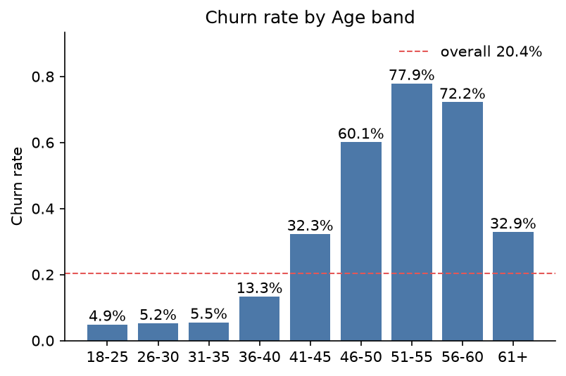
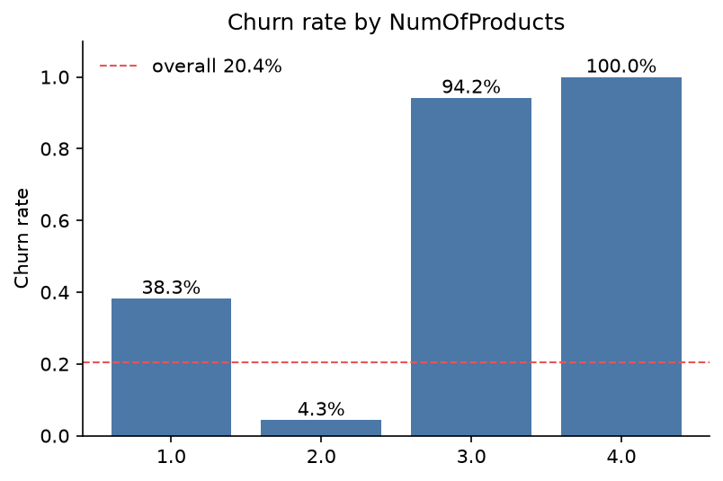
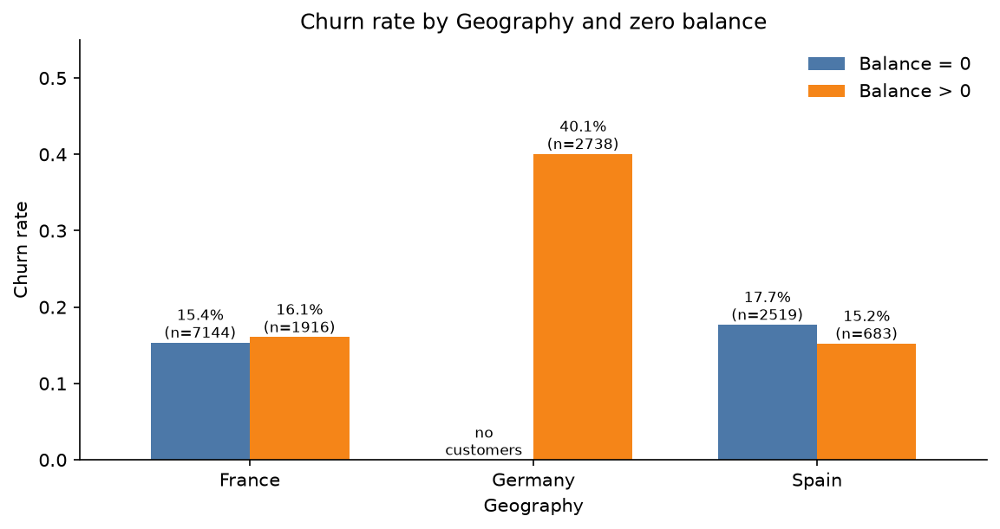
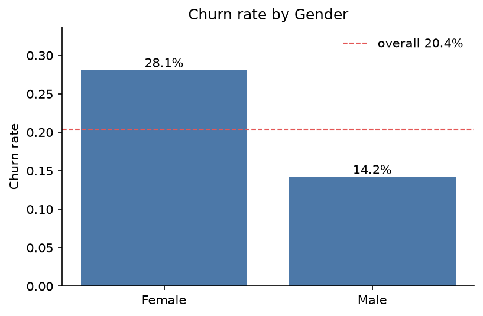
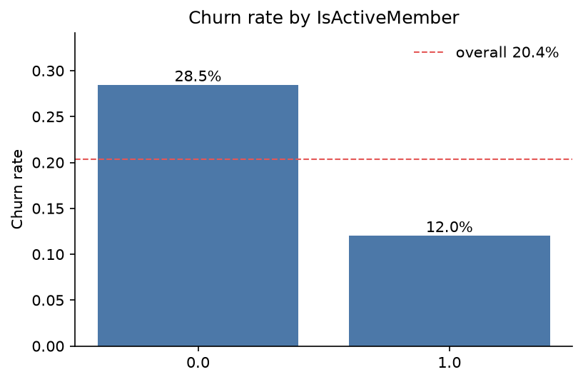
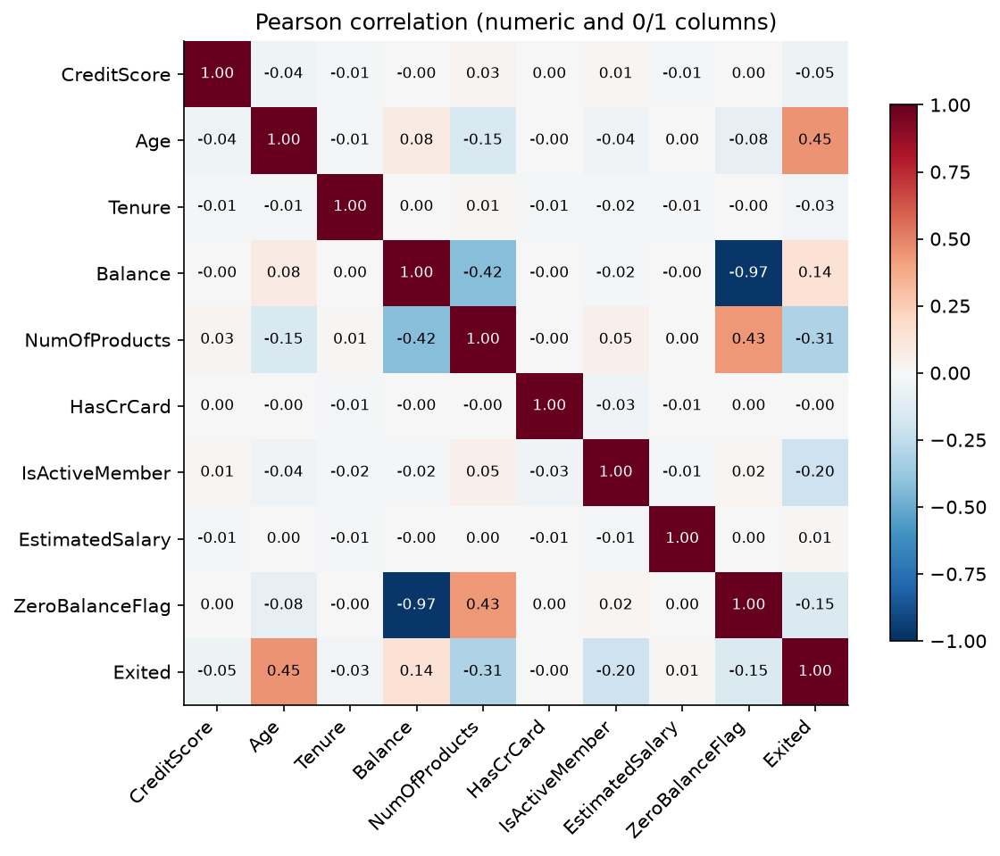

# EDA summary

Key findings from `notebooks/eda.ipynb`, run on `train.csv`. All charts are aggregated: no raw rows are shown, following the project data policy.
Each finding names the notebook section its chart comes from.

## Dataset snapshot

- 15,000 customers, 10 model features plus identifier columns that are dropped, and no missing values.
- Target `Exited`: 20.35% positives (about 3,050 customers), so the classes are imbalanced roughly 4 to 1. ROC-AUC is the right metric, and splits must be stratified.
- Data quality: 2 rows have an `EstimatedSalary` around 18M (the rest is below 200k) and 1 row has `Tenure` 30 (the rest is 0–10). They are data errors that would distort a scaler.
- The 0/1 columns and the categorical ones behave as expected: 64.4% of customers have `Balance` exactly 0, and `NumOfProducts` is 1 or 2 for 98.5% of them.

## Findings

### 1. Age is the strongest signal, and it is not linear

Chart: *Age band* section.

Churn is flat at about 5% up to age 35, then rises to 13.3% (36-40), 32.3% (41-45), 60.1% (46-50) and peaks at 77.9% for 51-55. It falls back to 32.9% above 60, in a small group of 213 customers.
**Implication:** a plain linear term sees only part of this shape. Age bands, a spline or tree-based models should help in E2.

### 2. Customers with exactly 2 products almost never leave

Chart: *Number of products* section.

Churn is 4.3% for 2 products (8,301 customers), 38.3% for 1 product, and 94.2% and 100% for 3 and 4 products. The last two groups are tiny (208 and 18 customers), so their exact rates are noisy.
**Implication:** `NumOfProducts` should not be treated as a plain number, because the "exactly 2" effect is what matters.

### 3. Germany churns twice as much, and balance is only a proxy for it

Chart: *Geography and zero balance together* section.

Germany has 40.1% churn (2,738 customers), against 15.5% in France and 17.2% in Spain. Every German customer has a positive balance, while about 79% of French and Spanish customers have zero.
Inside France the churn rate is 15.4% with zero balance and 16.1% with positive, and in Spain it is 17.7% and 15.2%. The apparent gap between zero and positive balance (16.0% against 28.3%) comes from Germany.
**Implication:** `Geography` is needed as a feature. `Balance` carries little extra signal once Geography is known, so a separate zero-balance flag is not worth adding.

### 4. Women churn about twice as often as men

Chart: *Gender* section.

Women churn at 28.1% (6,643 customers) and men at 14.2% (8,357 customers). The groups are large and balanced, so the gap is a stable signal.
**Implication:** a two-valued feature with a clear effect; one-hot encoding is enough.

### 5. Inactive members churn more than twice as much

Chart: *Active member* section.

Inactive members churn at 28.5% (7,605 customers) and active members at 12.0% (7,395 customers).
**Implication:** `IsActiveMember` is a clean 0/1 signal and can stay numeric, as the throwaway pipeline does.

### 6. Four features carry almost no signal

Chart: *Correlation matrix* section.

Against `Exited`, Age (0.45), NumOfProducts (-0.31) and IsActiveMember (-0.20) have the largest correlations. CreditScore, Tenure, HasCrCard and EstimatedSalary are all below 0.05 in absolute value, which the segment charts in the notebook confirm (for example, churn is 20.7% without a credit card and 20.3% with one).
`Balance` and its zero-balance flag correlate at -0.97, so they are the same information.
**Implication:** the weak features can stay in the model, since they do no harm, but they should not be expected to move the metric. Pearson misses the non-linear shapes of findings 1 and 2, so their real importance is higher than these coefficients suggest.

## What this means for the model

- The baseline already reaches a mean ROC-AUC of 0.8789 with logistic regression (see the README), so a linear model already captures a good part of the signal.
- The clearest room for improvement is the non-linear shape of Age and NumOfProducts, which tree-based models capture without extra work. This is for E2, not for this spec.
